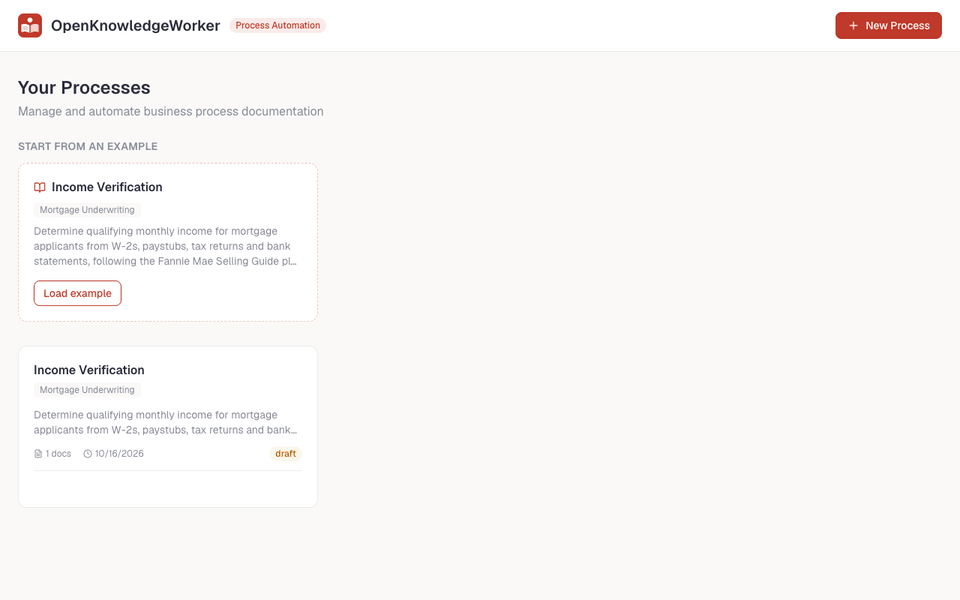
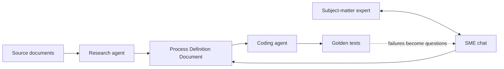
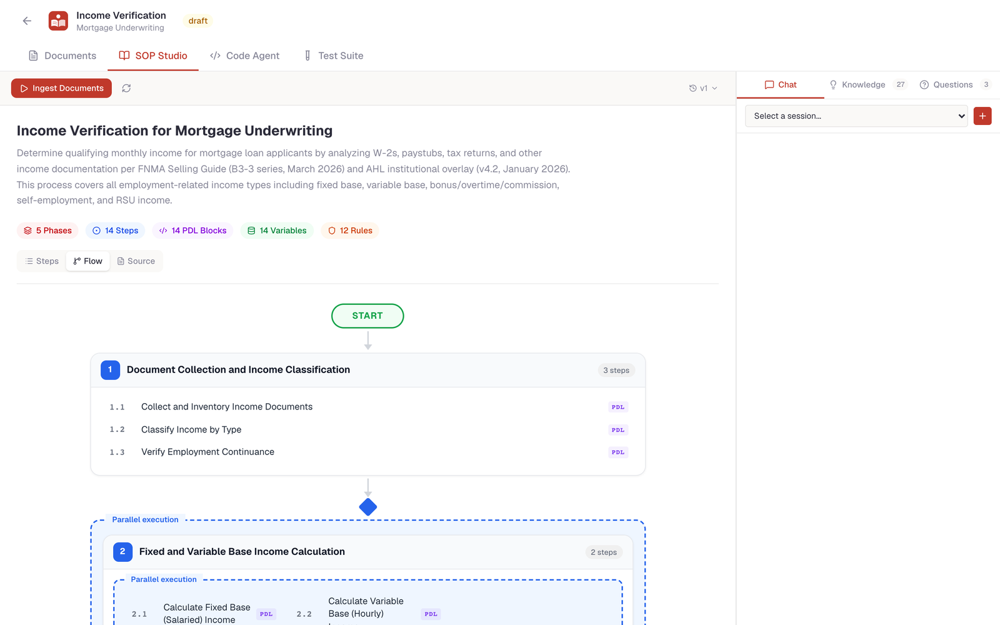
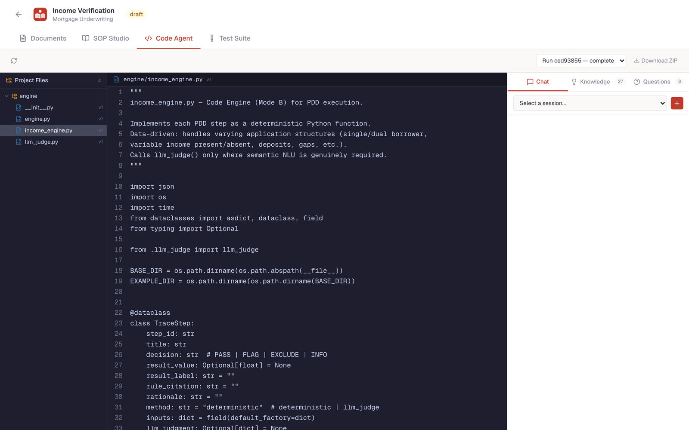
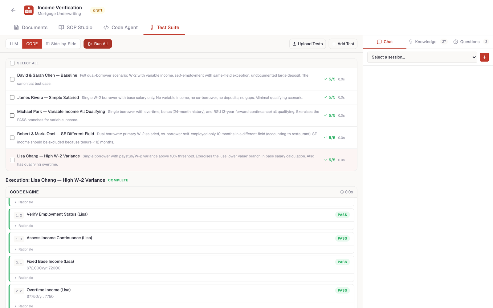

<p align="center">
  <picture>
    <source media="(prefers-color-scheme: dark)" srcset="assets/logo-wordmark-dark.svg">
    
  </picture>
</p>

<p align="center">
  <a href="LICENSE"></a>
  
  
  
</p>

<p align="center">
  <b>Turn policy manuals and expert know-how into auditable, tested automation.</b>
</p>

**OpenKnowledgeWorker** reads the documents a team works from (regulatory guides, policy
manuals, internal overlays) and interviews subject-matter experts to resolve the gaps and
conflicts. The result is an evidence-backed **Process Definition Document (PDD)**. A coding
agent then turns the PDD into deterministic Python, and golden test cases verify it, step by
step.

Every statement traces back to a source or an expert answer, and every generated decision
traces back to a PDD step. That makes it a fit for rule-heavy knowledge work where "the AI
said so" isn't good enough: lending, compliance, finance and operations.

<p align="center">
  
  <br><sub>Live run (sped up): an expert answer becomes a reviewed PDD change, the coding agent regenerates a tested engine, and the golden test passes for both the generated code and the LLM.</sub>
</p>

## Try it in 5 minutes

Clone this repository, then from its root:

```bash
cp .env.example .env    # optional: add an LLM API key for the agents
docker compose up --build
```

Open **http://localhost:3000**. A complete **mortgage income verification** example is
loaded on first start, with sources, a PDD, knowledge, open questions, a reference engine,
and golden tests. Open it, go to **Test Suite**, pick **CODE**, and press **Run All**.
No API key is needed to explore the example or run code-mode tests. The agents (research,
SME chat, code generation, LLM-mode tests) need a key.

## How it works



1. **Ingest:** upload PDFs, HTML or Markdown. Text is extracted, chunked and indexed as
   evidence.
2. **Research:** an agent drafts the PDD (phases, steps, and PDL decision logic), records
   knowledge items, and raises prioritized open questions where sources disagree or are
   silent.
3. **Elicit:** chat with the agent as the expert. It resolves questions, edits the PDD, and
   tracks provenance and versions.
4. **Generate:** a coding agent writes a multi-file Python engine, one function per PDD step,
   runs its own tests in a sandbox, and fixes failures. Semantic judgments use bounded
   "LLM judge" calls.
5. **Verify:** run golden test cases against the generated code, against the LLM following the
   PDD directly, or both side by side. Then compare decision traces step by step.

| SOP Studio | Code agent | Test suite |
|---|---|---|
|  |  |  |

## Features

- **Evidence-first process definitions:** statement-to-source links, PDD versions and diffs,
  and source-change impact analysis (API; UI help wanted).
- **Agents with tools, not just chat:** research, SME chat, and coding agents act through
  typed tools (edit PDD, resolve questions, write files, run tests).
- **Generated code you own:** plain Python with no runtime dependency on this project.
  It's downloadable, and every function maps to a PDD step.
- **Golden-test verification:** per-step assertions, code vs. LLM execution, and recorded
  judgments for deterministic tests.
- **Domain packs:** the core prompts are domain-neutral. A
  [domain pack](examples/README.md) supplies a domain's sources, output contract, guidance
  and tests.
- **Bring your own model:** Claude (default), or any OpenAI-compatible endpoint, including
  local models through Ollama or vLLM.
- **Built to keep running:** long agent runs survive browser disconnects, generated code
  runs in a secret-free sandbox, and changes are recorded in an audit log.

## Configuration

Settings live in `.env` (see [`.env.example`](.env.example)). The most important ones:

| Setting | Default | Notes |
|---|---|---|
| `LLM_PROVIDER` | `anthropic` | `anthropic` or `openai` (any OpenAI-compatible API) |
| `LLM_MODEL` | `claude-opus-5-5` for Anthropic | Required for `openai` |
| `ANTHROPIC_API_KEY` / `OPENAI_API_KEY` | | API key for the chosen provider |
| `OPENAI_BASE_URL` | | e.g. `http://localhost:11434/v1` for Ollama |
| `DATABASE_URL` | local Postgres | Set automatically by Docker Compose |

## Local development

Prerequisites: Python 3.11+, Node.js 20+, [pnpm](https://pnpm.io/), PostgreSQL 14+.

```bash
cp .env.example .env && createdb openknowledgeworker
make install     # backend virtualenv, frontend packages, pre-commit hooks
make db seed     # run migrations, load the example domain packs
make backend     # http://localhost:5003   (in one terminal)
make frontend    # http://localhost:3000   (in another)
make test lint   # everything CI runs
```

Run `make help` for all targets. [CONTRIBUTING.md](CONTRIBUTING.md) explains the workflow.

## Repository layout

```text
backend/          Flask API · agents (app/agent) · LLM providers (app/llm) · sandbox · jobs
frontend/         Next.js app (App Router, Tailwind)
examples/         Domain packs: the mortgage income verification example lives here
docs/             Architecture guide, glossary, vision, good first issues
```

## Documentation

- [Architecture: how it works today](docs/architecture.md)
- [Glossary](docs/glossary.md): PDD, PDL, knowledge items, LLM judge, domain pack, …
- [Domain packs](examples/README.md): add a new domain without touching the core
- [Vision / target architecture](docs/vision/README.md)
- [Roadmap](ROADMAP.md) · [Changelog](CHANGELOG.md) · [Security](SECURITY.md)

## Contributing

Contributions are welcome, from bug reports to new domain packs. Start with
[CONTRIBUTING.md](CONTRIBUTING.md) and the [good first issues](docs/good-first-issues.md).
Please follow our [Code of Conduct](CODE_OF_CONDUCT.md).

## Status

OpenKnowledgeWorker is **early-stage (0.x)**. There is no built-in authentication yet, so
run it on a trusted network (see [SECURITY.md](SECURITY.md)). Interfaces may change between
minor versions.

## License

[Apache License 2.0](LICENSE). See [NOTICE](NOTICE) for third-party attributions.
