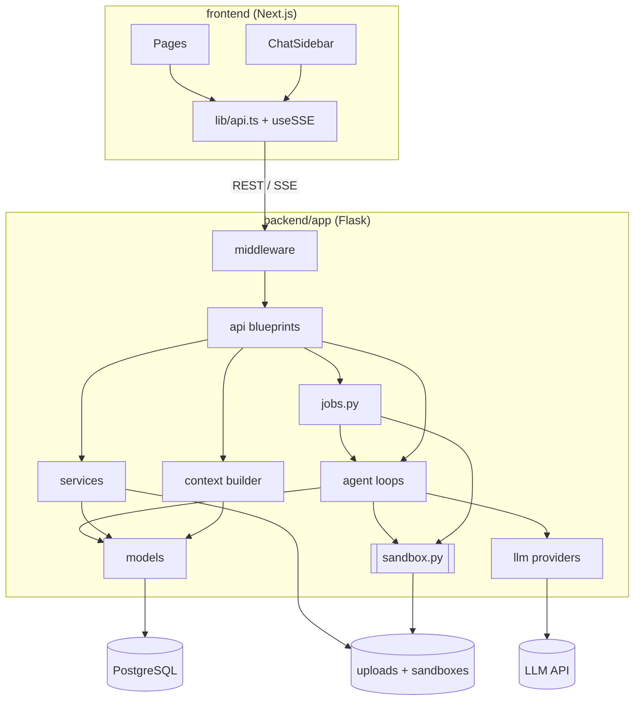

# Architecture: How It Works Today

This guide explains how the code in this repository works **today**, for contributors. It is
deliberately narrower than the [target architecture](vision/README.md), which describes
tenants, approvals, releases, and other capabilities that are not implemented yet.

## Big picture

OpenKnowledgeWorker is a single Flask backend plus a Next.js frontend, backed by PostgreSQL.
Everything is scoped to a **process** (for example, *Income Verification*). There is no
authentication or multi-tenancy; see [SECURITY.md](../SECURITY.md).

## Request flow

1. **Frontend.** Pages live under `frontend/src/app/processes/[id]/` (`documents`, `pdd`,
   `code`, `tests`). All HTTP calls go through `frontend/src/lib/api.ts`. Streaming endpoints
   are consumed with `frontend/src/lib/useSSE.ts`. The chat panel is
   `frontend/src/components/shared/ChatSidebar.tsx`; it sends a `context` (`sop`, `code`, or
   `tests`) so the backend picks the matching system prompt.
2. **App factory.** `backend/app/__init__.py:create_app()` loads config from the root `.env`
   (`backend/app/config.py`), enables CORS for `FRONTEND_URL`, installs middleware
   (`backend/app/middleware/`), initializes the database session, and registers blueprints.
3. **Blueprints.** `backend/app/api/__init__.py` registers one blueprint per resource. Almost
   all routes are mounted under `/api/processes/<process_id>/...`:

   | Blueprint file | Routes (under `/api/processes/<id>`) | Purpose |
   | --- | --- | --- |
   | `processes.py` | `/api/processes` | CRUD for processes |
   | `documents.py` | `/documents` | Upload, list, chunks, raw content |
   | `pdd.py` | `/pdd`, `/pdd/versions`, `/pdd/diff`, `/pdd/research` | PDD read/edit, versions, research agent (SSE) |
   | `chat.py` | `/chat/sessions` | Chat sessions; `.../message` streams the agent (SSE) |
   | `knowledge.py`, `questions.py` | `/knowledge`, `/questions` | Knowledge items and open questions |
   | `coding_agent.py` | `/coding/...` | Coding agent (background job, SSE), projects, files, mapping, download |
   | `test_suite.py` | `/tests/...` | Test cases, bulk import, runs (background job, SSE) |
   | `jobs.py` | `/jobs`, `/jobs/<job_id>/events` (also `/api/jobs/<job_id>/events`) | Job status; re-attach to a job's event stream |
   | `domain_packs.py` | `/api/domain-packs`, `/api/domain-packs/<id>/install` | List bundled domain packs; create a process from one |
   | `evidence.py` | `/evidence/...` | Evidence graph (experimental, no UI) |
   | `golden_datasets.py` | `/golden-datasets/...` | Built-in golden datasets (experimental, no UI) |
   | `transcripts.py` | `/transcripts/...` | Agent-run transcripts (experimental, no UI) |
   | `health.py` | `/health`, `/ready` | Liveness and readiness |

4. **Services and agents.** Blueprints stay thin where possible and delegate to
   `backend/app/services/` (deterministic logic) or `backend/app/agent/` (LLM loops).
5. **Models.** SQLAlchemy 2.x declarative models in `backend/app/models/`, sharing `Base`
   from `backend/app/extensions.py`. Code obtains a scoped session with `get_db()`.

## Agent loops

### Chat and research agent

`backend/app/agent/chat_agent.py` implements the tool-calling loop used by both the
research flow and SME chat:

- `run_agent_loop()` streams model output and executes tool calls round by round (up to
  `MAX_TOOL_ROUNDS`), yielding events of type `delta`, `tool_call`, `tool_result`, `done`,
  and `error`. Assistant turns are appended exactly as the provider returned them (including
  provider-specific blocks such as thinking), and a `max_tokens` cut-off triggers a
  continuation. It can record every request, response, and tool call through a
  `TranscriptRecorder` (`backend/app/services/transcript.py`).
- `run_agent_streaming()` is the same loop without transcript recording, used by research
  and chat.

Tools are defined in `backend/app/agent/tool_registry.py`. `create_process_tools(process_id,
session_id=None)` builds a `ToolRegistry` of `ToolDef`s bound to one process: reading and
editing the PDD (`read_pdd`, `propose_pdd_edit`, `edit_pdd_text`, `validate_pdd`), knowledge
(`read_knowledge`, `write_to_knowledge`), questions (`create_question`, `resolve_question`,
`view_open_questions`), documents (`list_documents`, `read_document`,
`read_document_chunks`), generated code (`list_code_files`, `read_code_file`,
`update_code_file`, `start_coding_agent`), and test cases (`list_test_cases`,
`create_test_case`, `bulk_create_tests`, and so on).

Every PDD edit creates a new `PddVersion` (with `change_source` and `parent_version_id`)
and records `Provenance` rows for the new sentences.

System prompts live in `backend/app/agent/prompts.py` (`RESEARCH_SYSTEM_PROMPT`,
`CHAT_SYSTEM_PROMPT`, `CODE_CHAT_SYSTEM_PROMPT`, `TEST_CHAT_SYSTEM_PROMPT`,
`EXECUTE_LLM_PROMPT`). The research prompt defines the PDD format, including the PDL blocks
inside each step (see the [glossary](glossary.md)).

`backend/app/context/builder.py` assembles a token-budgeted context (documents, PDD,
knowledge, questions, chat, code, tests) for a `QueryMode` (`RESEARCH`, `SME_CHAT`,
`CODING`, `TEST_EXECUTE`). `GET /pdd/context` exposes it for inspection.

### Coding agent

`backend/app/agent/code_agent_loop.py` drives a plan → code → test → fix loop over the latest
PDD using `run_agent_loop()`. Its tools come from `backend/app/agent/code_tools.py`:
`read_pdd`, `write_file`, `read_file`, `list_files`, `delete_file`, `run_tests`,
`run_module`, and `mark_phase`.

The coding agent's system prompt is domain-neutral. `backend/app/agent/domain_context.py`
appends a **domain context** built from the process's domain pack and golden test cases: the
input format (a sample case), the output contract (summary keys the tests assert on), and
domain guidance.

Files are stored as `CodeFile` rows and mirrored to a sandbox directory on disk. `run_tests`
and `run_module` execute through `backend/app/sandbox.py`: a subprocess with an allow-listed
environment (no secrets) and a timeout; paths are validated against traversal. This is
**not** a container boundary; see [SECURITY.md](../SECURITY.md). After generation, `backend/app/services/code_mapping.py`
extracts `CodeUnit`s (functions mapped to PDD step IDs and rule IDs) and flags units as
stale when the PDD changes.

### Test suite

`POST /tests/run` in `backend/app/api/test_suite.py` runs golden test cases in one of three
modes: `code` (run the latest completed code project's `engine.engine.run_engine(case)` in
the sandbox), `llm` (have the model execute the PDD directly with `EXECUTE_LLM_PROMPT` plus
the domain context), or `both`. Results are checked with `backend/app/services/assertions.py`:
each `expected_assertions` key is compared with the result's `summary` (numbers within ±1,
objects as subsets, plus the built-in `min_flag_count`). Engines whose `run_engine` accepts
`mock_llm_judge` receive the test case's recorded judgments, so semantic steps are
deterministic.

### LLM providers and background jobs

- **LLM providers:** `backend/app/llm/`. `base.py` defines the provider-neutral interface
  (`stream()` yields `TextDelta` events and a final `StreamEnd` with an `LLMResponse`);
  `anthropic_provider.py` and `openai_provider.py` (OpenAI, Ollama, vLLM, LiteLLM, ...)
  implement it. Agents call `get_llm()` and never import a vendor SDK. Select a provider with
  `LLM_PROVIDER` / `LLM_MODEL` (see `.env.example`). Tests swap in a scripted fake
  (`backend/tests/fakes.py`).
- **Background jobs:** `backend/app/jobs.py`. Research, coding and test runs execute in a
  worker thread, not the HTTP request, so closing the browser does not stop them. Each run
  is tracked as a `Job` row (`job_type`, `status`, `progress_pct`); its events are buffered
  in memory with sequence numbers. Run the backend with **one** worker process (the default
  for `run.py` and Docker) so watchers reach the job's buffer.

## SSE streaming

Streaming operations return `text/event-stream` responses; each event is a JSON object
with a `type` field.

- **Long-running work** (research, coding, test runs): write a generator of event dicts and
  start it with `runner.submit(app, process_id=..., job_type=..., work=work)`, then return
  `runner.stream(job_id)` (see `api/pdd.py:research_process`). The first event is
  `{"type": "job", "job_id": ...}` and every event carries an SSE `id:`. If the connection
  drops, the frontend's `useSSE` hook re-attaches with
  `GET /api/jobs/<job_id>/events?after=<last id>`.
- **Short streams** (chat replies): wrap a generator with `sse_response()` from
  `backend/app/utils/sse.py` and emit events with `sse_event(dict)`. Capture
  `current_app._get_current_object()` and enter `app.app_context()` inside the generator.

## Data model

All tables hang off `Process` (`backend/app/models/process.py`).

| Area | Models | Notes |
| --- | --- | --- |
| Process | `Process` | Name, domain, description, key inputs/outputs |
| Sources | `Document`, `DocumentChunk` | Uploaded file metadata, extracted text, heading-aware chunks |
| PDD | `PddVersion`, `Provenance` | Append-only PDD versions; sentence-level provenance |
| Knowledge | `KnowledgeItem`, `Question` | Facts (`TENTATIVE`/`CONFIRMED`); open questions (`OPEN`/`ANSWERED`/`DISMISSED`) |
| Chat | `ChatSession`, `ChatMessage` | SME conversations, including tool calls |
| Code | `CodeProject`, `CodeFile`, `CodeUnit` | Generated projects, files, function-to-step mapping |
| Tests | `TestCase`, `TestRun` | Golden inputs and assertions; results per mode |
| Evidence | `EvidenceSpan`, `PddStatement`, `EvidenceLink`, `ChangeEvent` | Statement-to-source graph and change log |
| Operations | `Job`, `Transcript`, `AuditLog` | Long-running jobs, agent-run transcripts, request audit log |

Models use PostgreSQL types (`UUID`, `JSONB`). The backend unit tests in `backend/tests/`
run on in-memory SQLite through adapters in `backend/tests/conftest.py`.

## Domain packs

Everything domain-specific lives in a **domain pack** under `examples/<pack>/pack.json`
(format: [`examples/README.md`](../examples/README.md)).
`backend/app/services/domain_packs.py` validates and installs packs: it creates the process,
ingests bundled sources, imports test cases, stores the output contract and agent guidance
in `process.metadata["domain_pack"]`, and optionally loads sample outputs and a reference
engine. `backend/seed.py` and `POST /api/domain-packs/<id>/install` both use it.

## Experimental APIs (no UI yet)

These endpoints work but have no frontend. They are good contribution targets (see
[good first issues](good-first-issues.md)):

- **Agent-run transcripts** (`/transcripts`): step-by-step records of coding-agent runs.
- **Golden datasets** (`/golden-datasets`): built-in multi-domain datasets in
  `backend/app/services/golden_datasets.py` with an output validator.
- **Evidence graph** (`/evidence`): build statement-to-evidence links, list statements and
  their evidence, document-removal impact, change events, and stats.

## Where to add things

**A new API endpoint**

1. Add a route to the relevant blueprint in `backend/app/api/`, or create a new module with a
   `Blueprint` and register it in `backend/app/api/__init__.py`.
2. Put non-trivial logic in `backend/app/services/` so it can be unit tested.
3. Add a typed client function to `frontend/src/lib/api.ts`.
4. Add a test in `backend/tests/` (see `test_chat_api.py` for the Flask test client pattern).

**A new agent tool**

1. Define the function and register a `ToolDef(name, description, input_schema, handler)` in
   `create_process_tools()` in `backend/app/agent/tool_registry.py` (chat/research agent) or
   `create_coding_tools()` in `backend/app/agent/code_tools.py` (coding agent).
2. Tools return a string (usually JSON) that is fed back to the model; never raise for expected
   errors.
3. Mention the tool in the relevant prompt in `backend/app/agent/prompts.py` if the agent
   needs guidance on when to use it.
4. Add a test in `backend/tests/test_tool_registry.py`.

**A new model or column**

1. Add or change the model in `backend/app/models/` and export it from
   `backend/app/models/__init__.py`.
2. Add `to_dict()` for API serialization, following the existing models.
3. Generate a migration: `cd backend && alembic revision --autogenerate -m "describe change"`.
   Review the generated file in `backend/alembic/versions/` by hand, then run
   `alembic upgrade head`.

**A new LLM provider**

Subclass `LLMProvider` in `backend/app/llm/` (implement `stream()`; translate the neutral
content-block messages and tool schemas to your API), register it in `create_provider()` in
`backend/app/llm/__init__.py`, and add translation tests like
`backend/tests/test_llm_providers.py`.

**A new domain**

Add a domain pack; no core changes are needed. See [`examples/README.md`](../examples/README.md).

**A new frontend page**

Add a route under `frontend/src/app/processes/[id]/` and add it to `NAV_ITEMS` in
`frontend/src/app/processes/[id]/layout.tsx`. Use the `--okw-*` CSS variables from
`frontend/src/app/globals.css` for colors.
