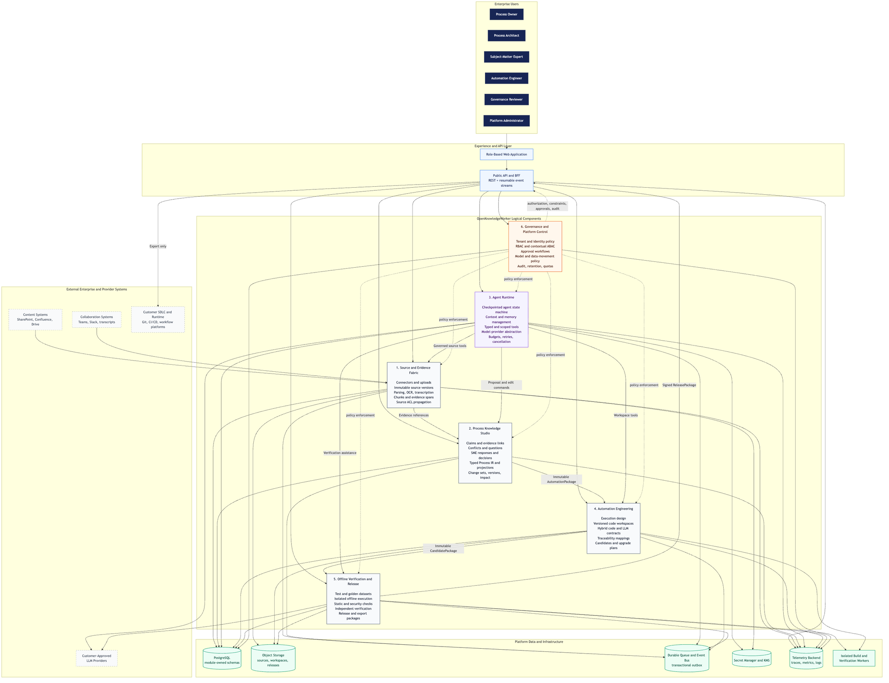

# OpenKnowledgeWorker Component Diagram

## Purpose

This diagram shows the logical component boundaries, primary responsibilities, owned data, and supported external systems. It is a logical architecture; the six components do not imply six independently deployed microservices.

Diagram source: [`../diagrams/component-diagram.mmd`](../diagrams/component-diagram.mmd) (re-render with `make diagrams`).

## Boundary rules

1. Source and Evidence records what sources say; Process Knowledge determines what the organization accepts as process truth.
2. Agent Runtime owns run state only. It proposes changes through governed component interfaces and cannot publish or approve domain artifacts.
3. Automation Engineering accepts only an immutable, approved `AutomationPackage`.
4. Verification accepts only an immutable `CandidatePackage`; repairs create a new candidate.
5. Governance evaluates access and mutation policy at every component boundary.
6. Production deployment and live execution occur beyond the OpenKnowledgeWorker boundary.
