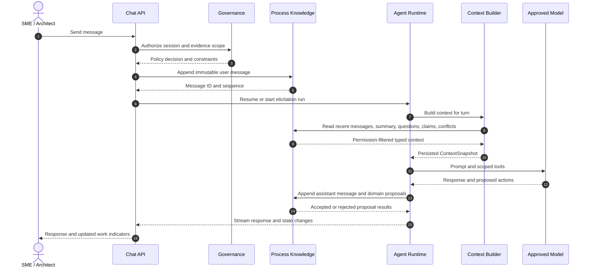

# OpenKnowledgeWorker Memory and Collaboration-State Architecture

## Review objective

This document defines how OpenKnowledgeWorker remembers what sources and people said, what the organization accepts as true, what remains unresolved, who owns the next action, what agents are doing, and which code and tests depend on each process rule. It is intended to support a 30-minute architect/staff MLE review and supplements [`system-design.md`](system-design.md).

## Executive summary

OpenKnowledgeWorker must not implement memory as a vector database of chat summaries. Organizational memory requires multiple stores with different authority, retention, and retrieval rules.

```text
Evidence memory
Documents, source versions, messages, expert responses
                         |
                         v
Organizational memory
Claims, conflicts, decisions, effective dates, Process IR
                         |
                         v
Maintenance memory
Evidence -> rule -> code -> test -> release dependencies

Collaboration state              Agent working state
Questions, assignments,          Runs, checkpoints, tools,
reviews and approvals            context, budgets, summaries
```

The central rule is:

> An agent summary may help retrieve or reason about information, but it is never the authoritative record of organizational truth.

## Goals

- Preserve complete, auditable source and conversation history.
- Resume conversations and agent work over days or months.
- Support multiple experts with different or conflicting knowledge.
- Track pending questions, responsibility, dependencies, and deadlines.
- Build compact model context without sending all history.
- Separate proposed knowledge from approved organizational truth.
- Detect stale knowledge when sources or decisions change.
- Trace evidence through process rules into code, tests, and releases.
- Enforce tenant, source, and role permissions during retrieval.

## Non-goals

- Personal-assistant preference memory unrelated to a process.
- Autonomous changes to approved knowledge.
- Production case state or workflow monitoring.
- Treating embeddings or summaries as canonical.
- Training foundation models on customer data.

## Memory taxonomy

| Memory class | Examples | Canonical? | Owner |
|---|---|---:|---|
| Evidence | Documents, exact messages, attachments | Yes, as evidence | Source Fabric / Process Knowledge |
| Organizational knowledge | Claims, decisions, Process IR, approvals | Yes | Process Knowledge |
| Collaboration state | Questions, assignments, reviews, work items | Yes, as workflow state | Process Knowledge |
| Agent working state | Runs, checkpoints, tool results | Yes for replay; not business truth | Agent Runtime |
| Derived retrieval memory | Embeddings, summaries, rankings | No; rebuildable | Agent Runtime / retrieval subsystem |
| Traceability memory | Evidence-to-rule-to-code-to-test edges | Yes | Process Knowledge / Automation / Verification |

## Ownership boundaries

```text
Source and Evidence Fabric
├── source artifacts and versions
├── document chunks and evidence spans
├── chat attachments
└── source ACL snapshots

Process Knowledge Studio
├── chat sessions and immutable messages
├── claims, conflicts and decisions
├── questions and expert responses
├── work items and assignments
├── Process IR and process versions
└── activity timeline projection

Agent Runtime
├── agent runs and checkpoints
├── model/tool transcripts
├── context snapshots
├── summaries and working memory
└── budgets and run status

Automation Engineering / Verification
└── rule-to-code-to-test-to-release traceability
```

No component reads another component's tables directly. Components use application interfaces and versioned events, even in the initial modular-monolith deployment.

# Core data model

## Chat memory

### ChatSession

```text
- id, tenant_id, process_id
- title and purpose
- status: ACTIVE | PAUSED | COMPLETED | ARCHIVED
- participant_refs[]
- related_question_ids[]
- created_by, created_at, updated_at
- aggregate_version
```

### ConversationMessage

```text
- id, tenant_id, session_id, sequence
- author_type: USER | AGENT | SYSTEM
- author_id
- content and content_format
- attachment_refs[]
- reply_to_message_id
- visibility_scope
- message_digest
- created_at
```

Messages are immutable. A correction is a new message referencing the original. A governed privacy deletion leaves a tombstone when policy permits.

### SessionSummary

```text
- id, session_id
- covers_sequence_start / covers_sequence_end
- summary and open_threads[]
- referenced_claim_ids[] / referenced_question_ids[]
- source_message_ids[]
- model_id / prompt_version
- generated_at / invalidated_at
```

Summaries are derived retrieval aids. They never replace messages and are regenerated when source messages or permissions change.

## Organizational knowledge

### KnowledgeClaim

```text
- id, tenant_id, process_id
- assertion
- status: PROPOSED | DRAFT | CONFIRMED | DISPUTED | SUPERSEDED
- confidence
- applicability_scope
- effective_from / effective_to
- owner_role
- supersedes_claim_id
- created_by, aggregate_version
```

`applicability_scope` contains structured jurisdiction, product, business unit, customer segment, policy type, or other domain dimensions. It is not only free text.

### ClaimEvidenceLink

```text
- claim_id
- evidence_type: SOURCE_SPAN | CHAT_MESSAGE | EXPERT_RESPONSE | TEST_CASE | MANUAL_DECISION
- evidence_id
- relation: SUPPORTS | CONTRADICTS | ELABORATES
- verification: AUTO | REVIEWED | CONFIRMED
- relevance_score
- created_by, created_at
```

### ConflictCase

```text
- id, process_id
- status: OPEN | UNDER_REVIEW | RESOLVED | ACCEPTED_EXCEPTION
- conflicting_claim_ids[] and evidence_refs[]
- materiality
- owner_assignment_id
- resolution_decision_id
- created_at / resolved_at
```

### DecisionRecord

```text
- id, process_id, decision_type
- decision and rationale
- decided_by and approval_refs[]
- affected_claim_ids[]
- effective_period
- created_at
```

Decision records are append-only. A changed organizational position supersedes the prior decision.

## Pending questions and responses

### Question

```text
- id, process_id, display_id
- text and rationale
- status:
    DRAFT | OPEN | ASSIGNED | ANSWERED_PENDING_REVIEW
    RESOLVED | OBSOLETE | DISMISSED
- priority, due_at
- target_role_refs[]
- related_claim_ids[] / related_conflict_ids[] / related_step_ids[]
- source_evidence_refs[]
- supersedes_question_id
- created_by, aggregate_version
```

### ExpertResponse

```text
- id, question_id, respondent_id
- answer and applicability_scope
- exceptions[]
- confidence: LOW | MEDIUM | HIGH
- supporting_evidence_refs[]
- source_message_ids[]
- created_at
```

Expert responses are immutable evidence. They can create proposed claim changes but cannot directly modify approved knowledge.

```text
DRAFT -> OPEN -> ASSIGNED -> ANSWERED_PENDING_REVIEW -> RESOLVED
            |         |                   |
            |         |                   +-> OPEN (follow-up required)
            |         +-> OBSOLETE
            +-> DISMISSED
```

Every transition records a reason. `OBSOLETE`, for example, records which response or decision removed the need for the question.

## Who is working on what

Use generic work objects instead of adding ad hoc assignee fields to every entity.

### WorkItem

```text
- id, tenant_id, process_id
- work_type:
    REVIEW_CLAIM | ANSWER_QUESTION | RESOLVE_CONFLICT
    REVIEW_PROCESS_VERSION | REVIEW_EXECUTION_DESIGN
    RESOLVE_VERIFICATION_FINDING | APPROVE_RELEASE
- subject_type / subject_id
- title
- status: OPEN | CLAIMED | IN_PROGRESS | WAITING | BLOCKED | COMPLETED | CANCELLED
- priority, due_at
- created_by, created_at, updated_at
- aggregate_version
```

### Assignment

```text
- id, work_item_id
- assignee_type: USER | GROUP | ROLE | AGENT_RUN
- assignee_id
- assignment_role: OWNER | CONTRIBUTOR | REVIEWER | APPROVER
- status: ASSIGNED | ACCEPTED | DECLINED | RELEASED | COMPLETED
- assigned_by
- assigned_at / accepted_at / completed_at
- lease_expires_at
```

### WorkDependency

```text
- predecessor_work_item_id
- successor_work_item_id
- dependency_type: BLOCKS | INFORMS | SUPERSEDES
```

This supports group queues, explicit claiming, reassignment, multiple contributors, one accountable owner, blocked work, and role-specific dashboards.

Presence such as "Alice is viewing this claim" is ephemeral cache state. It is not an assignment and is never used for authorization.

## Agent working state

### AgentRun

```text
- id, tenant_id, process_id
- agent_definition_id / version
- objective
- status:
    QUEUED | RUNNING | WAITING_FOR_TOOL | WAITING_FOR_APPROVAL
    PAUSED | CANCELLING | CANCELLED | FAILED | COMPLETED
- current_phase, initiated_by, parent_run_id
- operation_id, checkpoint_sequence
- budget_state, terminal_reason
- created_at / started_at / completed_at
```

### RunCheckpoint

```text
- run_id, sequence
- runtime_state and message_refs[]
- pending_tool_calls[]
- context_snapshot_id
- budget_state and transition_reason
- created_at
```

### ContextSnapshot

```text
- id, run_id, query_mode
- selected_context_items[]
- source_versions[]
- policy_decision_refs[]
- token_estimate
- ranking_configuration_version
- digest, created_at
```

Context snapshots make behavior explainable: OpenKnowledgeWorker can show what an agent was permitted to see and what it actually received for a model call.

## Traceability and maintenance memory

```text
EvidenceSpan / ChatMessage / ExpertResponse
                    |
                    v
              KnowledgeClaim
                    |
                    v
             Rule / ProcessStep
                    |
                    v
      Function / SemanticContract / Test
                    |
                    v
             BuildCandidate / Release
```

Edges use stable IDs and artifact digests. Line numbers are display metadata, not durable identity.

This graph answers which rules depend on a changed source, which questions and decisions are affected, which functions and tests implement the rules, and which releases contain prior behavior.

# Chat processing lifecycle



Rules:

1. Persist the user message before model invocation.
2. Assign a monotonic sequence within the session.
3. Persist assistant output and tool activity separately.
4. Link extracted proposals to exact source messages.
5. Do not infer approval from model use of a statement.
6. Generate summaries asynchronously after a successful turn.

# Context assembly and retrieval

## Retrieval pipeline

```text
1. Resolve actor, tenant, process, task and query mode
2. Enforce source and resource permissions
3. Identify mandatory context
4. Generate candidates from typed stores and indexes
5. Filter by applicability and effective time
6. Rank by relevance, authority, freshness and confidence
7. Allocate token budget by context class
8. Deduplicate and compress
9. Persist ContextSnapshot
10. Invoke model
```

Conceptually:

```text
score = semantic_relevance
      * authority_weight
      * freshness_weight
      * applicability_weight
      * confidence_weight
```

Permission is a hard filter, not a score. Superseded or out-of-scope knowledge is excluded or explicitly labeled historical.

## Context classes

Mandatory context includes agent instructions, applicable policies, the current task, stable version IDs, and the current question/claim/finding/file.

Retrieved context may include evidence spans, approved or disputed claims, recent messages, summaries, open questions, process rules, relevant code symbols, tests, and findings.

| Mode | Primary context |
|---|---|
| Research | Evidence, claims, conflicts, process skeleton |
| SME elicitation | Assigned question, evidence, recent chat, related claims |
| Process design | Process IR, confirmed claims, gaps, validation findings |
| Implementation | AutomationPackage, approved design, relevant files |
| Repair | Finding, affected rules/files, failing tests |
| Maintenance | Changed evidence, impacted knowledge, prior decisions and mappings |

Budgets are dynamic rather than fixed percentages for every process size.

## Summary strategy

```text
Message-window summaries
-> session summary
-> topic/question summary
-> process activity summary
```

Each summary records its sources and covered message range. It becomes stale when referenced sources change, are deleted, or become unauthorized.

Do not summarize away exact thresholds, exceptions, negative conditions, effective dates, dissent, approval decisions, or required human review. Retrieve those as structured objects or exact evidence.

# Work queues and collaboration views

## My work

- Assigned questions.
- Claims awaiting review.
- Conflicts awaiting resolution.
- Process and design reviews.
- Verification findings.
- Approval decisions.

## Process workboard

- Open questions by role and due date.
- Conflicts by materiality.
- Active human and agent assignments.
- Blocked work and dependencies.
- Pending approvals.
- Recently completed work.

## Agent activity

- Objective, initiator, current phase and status.
- Last checkpoint and blocking reason.
- Time, token and cost usage.
- Proposed or created artifacts.
- Approval wait and authorized cancellation.

These views read normalized state. They do not infer work ownership by scraping chat or transcripts.

# Application interfaces

## Chat

```text
POST /v1/processes/{processId}/chat-sessions
GET  /v1/processes/{processId}/chat-sessions
GET  /v1/chat-sessions/{sessionId}
POST /v1/chat-sessions/{sessionId}/messages
GET  /v1/chat-sessions/{sessionId}/messages?afterSequence=...
GET  /v1/chat-sessions/{sessionId}/summary
POST /v1/chat-sessions/{sessionId}/pause
POST /v1/chat-sessions/{sessionId}/complete
```

Posting a message returns an asynchronous operation reference for agent response generation.

## Questions and responses

```text
GET  /v1/processes/{processId}/questions
POST /v1/processes/{processId}/questions
POST /v1/questions/{questionId}/assignments
POST /v1/questions/{questionId}/responses
POST /v1/questions/{questionId}/review
POST /v1/questions/{questionId}/obsolete
```

## Work and assignments

```text
GET  /v1/work-items?assignee=me&status=OPEN,IN_PROGRESS
GET  /v1/processes/{processId}/work-items
POST /v1/work-items/{workItemId}/claim
POST /v1/work-items/{workItemId}/assignments
POST /v1/work-items/{workItemId}/status
POST /v1/work-items/{workItemId}/release
```

## Agent runs

```text
POST /v1/agent-runs
GET  /v1/agent-runs/{runId}
GET  /v1/agent-runs/{runId}/events?cursor=...
POST /v1/agent-runs/{runId}/resume
POST /v1/agent-runs/{runId}/cancel
GET  /v1/processes/{processId}/agent-runs
```

## Activity

```text
GET /v1/processes/{processId}/activity?cursor=...
```

The activity timeline is a projection of domain and audit events, not the canonical store.

Every mutation derives tenant and actor identity and carries correlation, causation, idempotency, and expected-version metadata.

# Consistency and concurrency

- Update a component aggregate and its transactional outbox in one transaction.
- Use versioned, at-least-once events across components.
- Deduplicate consumers by event ID.
- Do not use distributed transactions.
- Apply optimistic concurrency to claims, questions, work items and change sets.
- Return `409 VERSION_CONFLICT` with current version and relevant diff.
- Human assignments persist until completed or released; group claims may use leases.
- Agent workers use renewable leases, checkpoints and idempotent tools.

# Freshness and invalidation

| Object | Trigger | Response |
|---|---|---|
| Evidence span | New/deleted source version or ACL change | Preserve history; update current applicability |
| Session summary | Covered message removal/correction | Mark stale and regenerate |
| Claim | Supporting evidence change or effective-period end | Create impact/review work |
| Question | Related issue resolved elsewhere | Review for obsolescence or revision |
| Retrieval index | Content or permission change | Reindex and enforce query-time filter |
| Code mapping | Rule or file digest change | Mark stale |
| Durable agent memory | Referenced version change | Invalidate or retrieve with warning |

Approved knowledge is never silently rewritten. A material change creates an impact assessment, change set, review, and new ProcessVersion.

# Security and privacy

1. Enforce tenant isolation in application services and database access; use PostgreSQL row-level security where practical.
2. Preserve source ACLs and user-delegated access where needed.
3. Filter context before ranking and model invocation.
4. Record what context was supplied to every model call.
5. Store secrets in a secret manager; memory stores references only.
6. Apply classification to messages, attachments, summaries and claims.
7. Apply tenant retention, deletion, legal-hold and residency policies.
8. Treat retrieved content as untrusted and defend tools against prompt injection.
9. Prevent cross-tenant vector-neighbor leakage.
10. Audit message access, claim changes, assignments, approvals, model calls and exports.

# Storage and retrieval implementation

- **PostgreSQL:** structured lifecycle, relationships, assignments and metadata.
- **Object storage:** raw sources, large renditions, snapshots and release bundles.
- **Durable queue/event bus:** operations and domain events.
- **PostgreSQL full-text search:** initial lexical retrieval.
- **pgvector or provider-neutral vector index:** semantic candidate retrieval.
- **Short-lived cache:** presence, leases, stream cursors and safe retrieval caches.

Embeddings are rebuildable. Record source/version ID, embedding model/version, chunking configuration, content digest, tenant and permission-filter attributes.

Introduce a separate search cluster only when scale or latency justifies it.

# Observability and MLE evaluation

## Operational metrics

- Open-question count, age and overdue rate.
- Work items by assignee, status and blocker.
- Claim/conflict review throughput.
- Agent runs by status and terminal reason.
- Context tokens by memory class.
- Retrieval latency and empty-result rate.
- Summary generation and invalidation rate.
- Policy filtering and denial rate.
- Stale dependency and mapping count.

## Quality metrics

- Evidence retrieval recall at K and citation precision.
- Claim extraction precision/recall.
- Conflict detection precision/recall.
- Question usefulness and duplicate rate.
- Summary consistency and omission rate.
- Correct exclusion of superseded/out-of-scope knowledge.
- Permission leakage tests.
- Context ablation: outcome quality versus token cost.

Evaluation sets should include contradictory documents, jurisdiction/effective-date differences, unequal SME authority, obsolete questions, source deletion, access revocation, long resumed chats, and changes that affect code/tests.

# Failure modes

| Failure | Mitigation |
|---|---|
| Chat statement becomes approved truth | Domain API only permits proposal; approval is separate |
| Summary drops a threshold or exception | Retrieve structured claims/exact evidence and evaluate summaries |
| Old policy ranks above new policy | Filter effective time and supersession before ranking |
| Concurrent overwrite | Optimistic concurrency and visible diff |
| Duplicate assignments | Idempotency and domain uniqueness rules |
| Presence is confused with ownership | Keep ephemeral presence separate from Assignment |
| Agent dies mid-task | Checkpoints, leases and idempotent tools |
| Source permission revoked | Query-time policy, ACL event and cache/index invalidation |
| Cross-tenant semantic leakage | Tenant partition/filter and adversarial tests |
| Removed evidence supports approved rule | Preserve history and create reviewed impact workflow |
| Unbounded growth | Retention tiers, summaries, budgets and archival |

# Architectural decisions

1. Chat is evidence, not truth.
2. Questions are first-class domain objects, not checklist text.
3. Work ownership is modeled separately from the underlying question or claim.
4. Agent transcripts explain execution; claims and Process IR represent accepted knowledge.
5. Summaries and embeddings are disposable retrieval structures.
6. Context snapshots are persisted for audit and evaluation.
7. Authority, effective time and applicability are retrieval primitives.
8. Material knowledge never self-updates without review.

# Recommended implementation sequence

## Phase 1: Collaboration state

1. Add immutable messages and versioned summaries.
2. Expand questions into the explicit state model.
3. Add work items, assignments and dependencies.
4. Build a process activity projection.

## Phase 2: Organizational memory

1. Replace generic knowledge rows with claims and evidence links.
2. Add applicability, effective periods, supersession and authority.
3. Add conflicts and append-only decisions.
4. Connect expert responses to proposed claim changes.

## Phase 3: Agent memory

1. Unify chat and coding loops under AgentRun and RunCheckpoint.
2. Persist context snapshots and policy/tool decisions.
3. Add hierarchical summaries and invalidation.
4. Apply per-mode token, cost and duration budgets.

## Phase 4: Maintenance memory

1. Add stable rule and step IDs to Process IR.
2. Map rules and steps to code symbols and tests.
3. Implement impact traversal and stale-edge detection.
4. Generate work from source/version changes.

# Open questions for review

1. Is expert authority reusable role policy, assessed per response, or both?
2. Which question/work transitions require approval?
3. What retention applies separately to messages, transcripts, summaries and model payloads?
4. Should full context snapshots be retained or represented by references and digests after a short period?
5. What corpus size and latency trigger a separate search service?
6. Must privacy workflows support cryptographic erasure of chat content?
7. Which accepted uncertainties still permit ProcessVersion publication?
8. What reproducibility is required for semantic LLM steps?
9. Should role queues use automatic load balancing or explicit claiming?
10. Which derived memory may cross process boundaries within a tenant?

# Review outcome sought

The review should confirm:

- The memory classes and ownership boundaries.
- Chat-as-evidence and claims-as-organizational-memory semantics.
- Question, assignment and agent-run state models.
- Context retrieval, summary and invalidation strategy.
- Consistency, security and retention posture.
- Phased implementation and unresolved policy choices.
