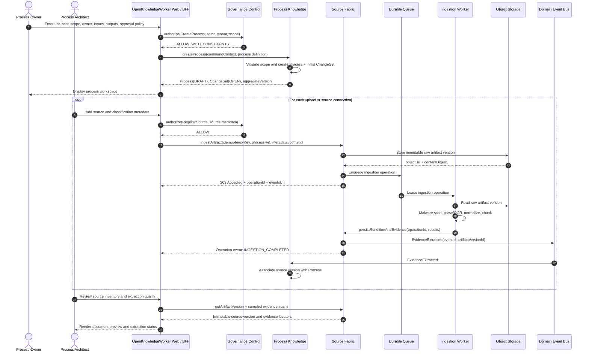

# Sequence Diagram: Use-Case Intake and Source Ingestion

## Participants

- Process Owner creates and scopes the use case.
- Process Architect supplies source material.
- Process Knowledge owns the process and initial change set.
- Source Fabric owns source artifacts, versions, and evidence.

## Key controls

- Upload commands are idempotent.
- Raw source versions are immutable and content-addressed.
- Ingestion runs asynchronously and can resume after worker failure.
- Source metadata and access are evaluated before evidence is returned.
- A failed parse creates a failed ingestion attempt, not a partially ready document.
