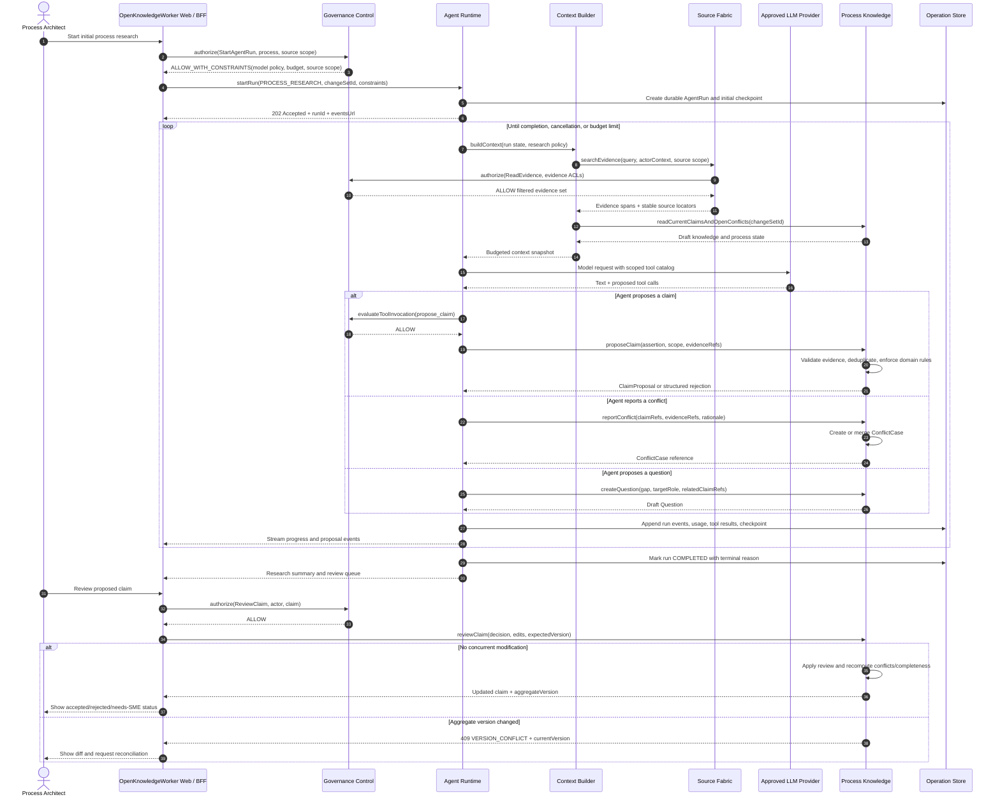

# Sequence Diagram: Research and Claim Review

## Purpose

This flow converts source evidence into proposed organizational knowledge. Agent output remains a proposal until reviewed through Process Knowledge.

## Key controls

- Context retrieval combines relevance, authority, freshness, applicability, and permission.
- The model cannot confirm claims or publish process knowledge.
- Tool invocations use the same application interfaces and policy checks as human actions.
- Each run is budgeted, checkpointed, cancellable, and completely traceable.
