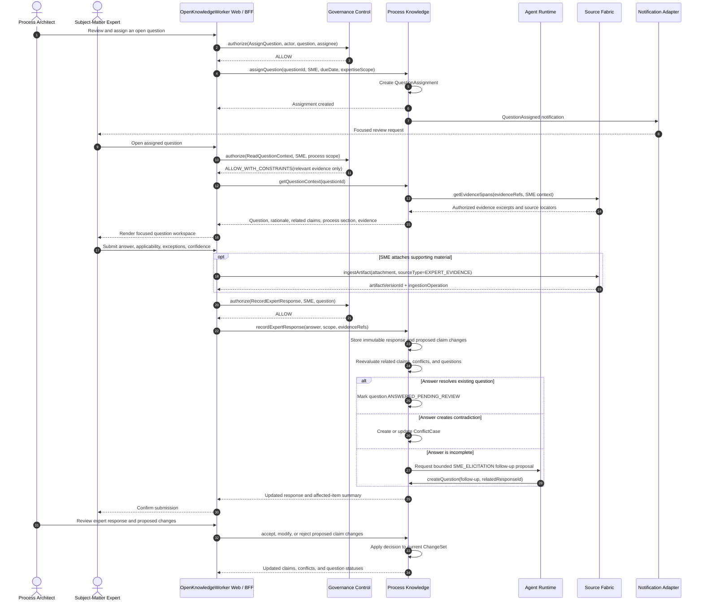

# Sequence Diagram: SME Elicitation

## Purpose

This flow captures organizational knowledge that cannot be resolved from documents. An expert response becomes evidence and a proposed knowledge change, not automatic process truth.

## Key controls

- SME access is limited to assigned process scope and authorized evidence.
- Expertise and authority are contextual; an SME is not globally authoritative.
- Original expert responses are immutable, even when the resulting claim is edited.
- Follow-up questions retain causation links to prior responses and conflicts.
