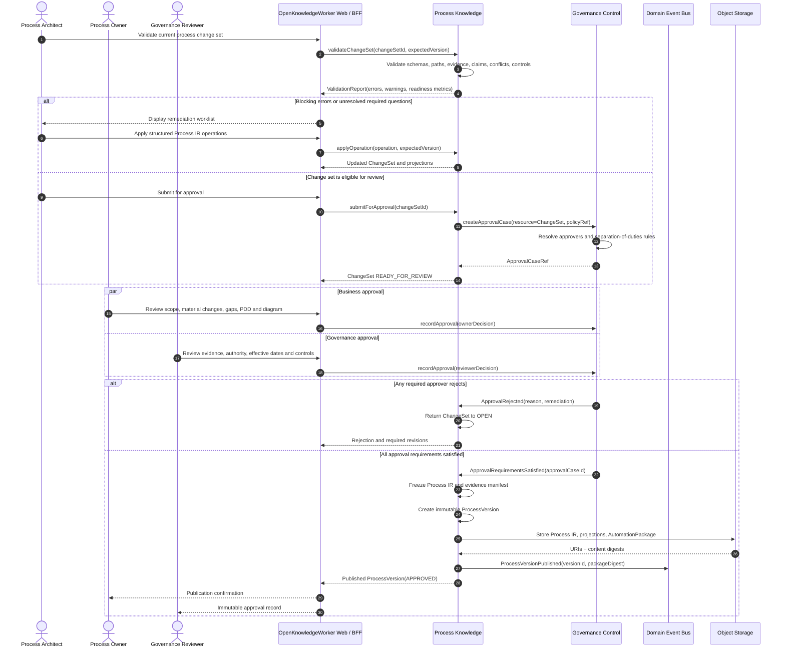

# Sequence Diagram: Process Review and Publication

## Purpose

This flow validates a Process IR, obtains required human approvals, and publishes an immutable `ProcessVersion` and `AutomationPackage`.

## Publication invariants

- No blocking validation error exists.
- All required questions and conflicts are resolved or explicitly accepted as exceptions.
- Required business and governance approvals are satisfied.
- The Process IR, evidence manifest, projections, and approvals are content-addressed and immutable.
- The actor who authored a material change cannot satisfy an approval role when separation of duties applies.
