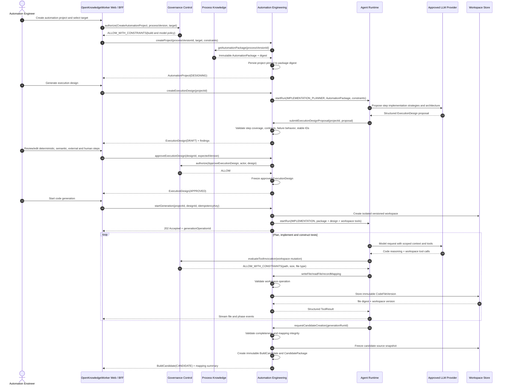

# Sequence Diagram: Automation Design and Code Generation

## Purpose

This flow creates a reviewed execution design and generates a versioned codebase from one immutable, approved process version.

## Key controls

- Generation is pinned to an immutable `AutomationPackage` digest.
- Execution design approval occurs before code generation.
- Agent tools cannot escape the project workspace.
- Agent Runtime does not own or directly persist code files.
- Candidate creation freezes source, dependency, mapping, prompt, and configuration versions.
