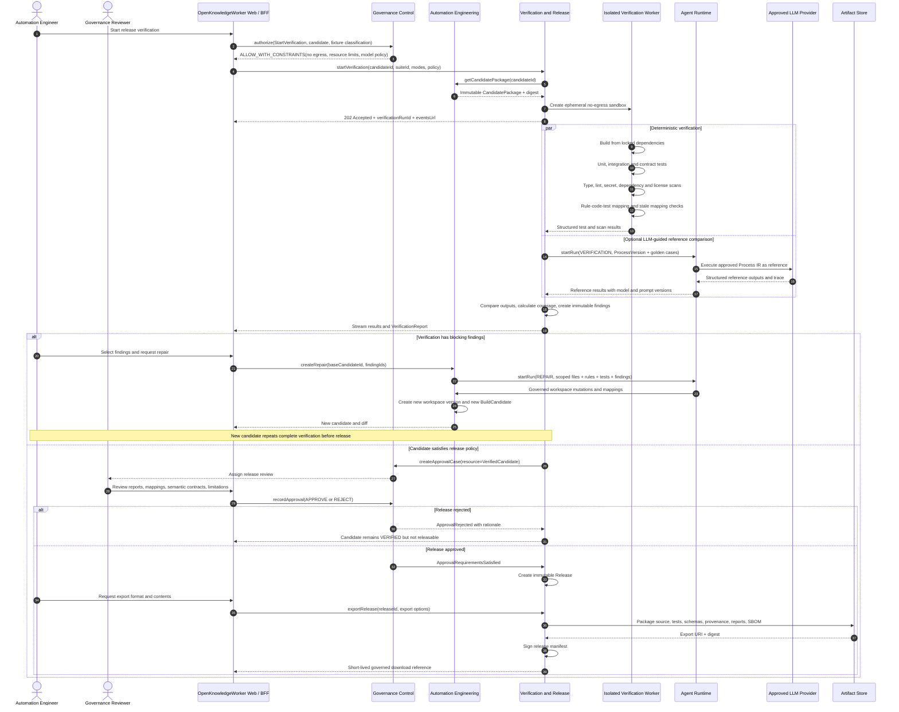

# Sequence Diagram: Offline Verification, Repair, and Release

## Purpose

This flow independently verifies an immutable candidate, performs controlled repair if necessary, obtains release approval, and creates an export bundle. It never processes live production cases.

## Release gates

- Candidate digest matches the verified CandidatePackage.
- Required suites and scans passed.
- Traceability coverage meets tenant policy.
- Accepted findings have recorded owners and rationale.
- Semantic contracts declare schemas, model policy, confidence thresholds, and fallback behavior.
- Required release approvals are satisfied.
